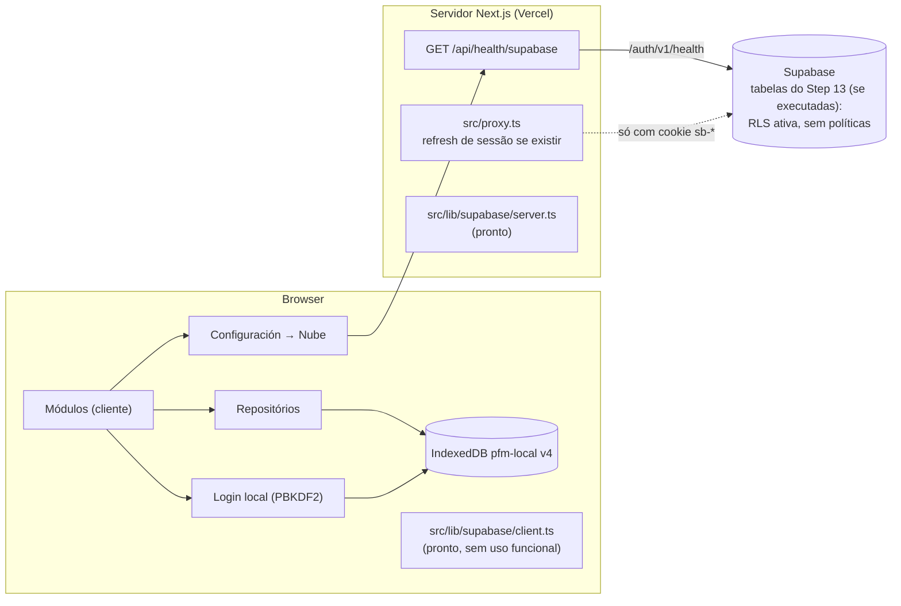

# Arquitetura do AUREON

Índice de alto nível. Estado em 2026-11-28 (Step 13). Detalhe: [architecture/overview.md](architecture/overview.md) (arquitetura atual, por camada) e [audit/supabase-blueprint.md](audit/supabase-blueprint.md) (destino).

## Implementado vs. planeado

| Área | Estado | Onde |
| --- | --- | --- |
| Next.js 16 App Router, páginas estáticas, PWA offline | **Implementado** | `src/app`, `scripts/pwa` |
| Domínio (Zod + regras puras), módulos financeiros | **Implementado** | `src/domain`, `src/features` |
| Dados no IndexedDB (`pfm-local` v4), repositórios com `outbox` | **Implementado — fonte de trabalho atual** | `src/services/storage`, `src/services/repositories` |
| Login local (PBKDF2) e perfil global | **Implementado — login ativo** | `src/services/auth`, `src/features/auth` |
| Exportação/importação JSON 2.4.0 | Implementado (sem UI de descarga) | `src/services/exchange` |
| Dependências Supabase (`@supabase/supabase-js` 2.119.2, `@supabase/ssr` 0.12.7) | **Implementado (Step 12)** | `package.json` |
| Configuração Supabase validada (Zod), recusa de chaves privilegiadas | **Implementado (Step 12)** | `src/lib/supabase/config.ts`, `next.config.ts` |
| Clientes Supabase de browser e de servidor | **Implementado (Step 12), ainda sem uso funcional** | `src/lib/supabase/client.ts`, `server.ts` |
| Proxy Next.js 16 (refresh de sessão, sem redirecionamentos) | **Implementado (Step 12)** | `src/proxy.ts`, `src/lib/supabase/proxy.ts` |
| Health check da ligação | **Implementado (Step 12)** | `src/lib/supabase/health.ts`, `/api/health/supabase`, Configuración → Nube |
| CSP global (com `connect-src` limitado ao projeto Supabase e à DolarApi) | **Implementado (Step 12)** | `next.config.ts` |
| Esquema PostgreSQL (17 tabelas, FKs compostas, CHECK, triggers, auditoria, RLS ativa sem políticas) | **Preparado e validado localmente (Step 13); por executar pelo utilizador no SQL Editor** | [database/sql/README.md](../database/sql/README.md), [database/](database/) |
| Supabase Auth (substitui o login local) | Planeado — Step 14 | [SUPABASE_SETUP.md](SUPABASE_SETUP.md) |
| Row Level Security | **Ativada sem políticas nos scripts (acesso de clientes bloqueado); políticas por utilizador no Step 15** | [database/SECURITY.md](database/SECURITY.md) |
| Sincronização nuvem ⇄ IndexedDB | Planeado | blueprint §6 |
| Cifragem ao nível da aplicação | Planeado — Step 18 (OD-11/12/13) | blueprint §5 |
| Backup JSON cifrado, independente do Supabase | Planeado | blueprint §8 |

## Visão atual (Step 12)

**Regras desta fase:**

- os dados financeiros e o login continuam locais;
- nada financeiro é enviado ao Supabase;
- sem variáveis configuradas, a app comporta-se exatamente como antes do Step 12.

## Decisões

[ADR-006](decisions/ADR-006-supabase-hibrido.md) (Supabase + IndexedDB) substitui o [ADR-001](decisions/ADR-001-sem-base-de-dados.md). Decisões em aberto: [decisions/open-decisions.md](decisions/open-decisions.md).
