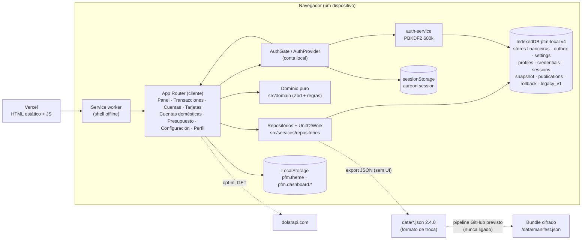

# AUREON — Step 11: auditoria de arquitetura e preparação da migração para Supabase

Data: 2026-11-28 · Base: árvore de trabalho atual (HEAD local `843ebd9` + alterações não commitadas dos Steps 06–10) · Decisão de destino: [ADR-006](../decisions/ADR-006-supabase-hibrido.md).

Documentos deste step:

| Documento | Conteúdo |
| --- | --- |
| **Este ficheiro** | Auditoria: o que existe, diagramas atual/proposto, inventário de entidades, autenticação, IndexedDB, segurança, riscos, respostas aos critérios de aceitação |
| [postgresql-mapping.md](postgresql-mapping.md) | Mapeamento entidade a entidade para tabelas PostgreSQL, com SQL de proposta (não é uma migração) |
| [supabase-blueprint.md](supabase-blueprint.md) | Arquitetura de destino: Auth, RLS, repositórios, sincronização, cifragem, backup, migração de contas, roteiro dos Steps 12–20 |
| [baseline-step-11.md](baseline-step-11.md) | Resultados da linha de base (testes, build, auditoria npm) |

Nada foi migrado: não há dependências novas, nem SQL executado, nem configuração de produção alterada.

> **Nota (Step 12):** os números de step entre parênteses nas tabelas abaixo seguem a proposta original do Step 11. A numeração oficial foi depois fixada no brief do Step 12 (RLS no Step 15, cifragem no Step 18) e está em [supabase-blueprint.md §9](supabase-blueprint.md). As fundações do Step 12 estão feitas: [ARCHITECTURE.md](../ARCHITECTURE.md).

---

## 1. Resumo executivo

- **O que existe:** uma PWA Next.js 16 estática e local-first. Os dados financeiros vivem no IndexedDB de cada navegador (`pfm-local`, v4) e são escritos por repositórios tipados que validam com Zod e regras de negócio, numa só transação IndexedDB, com uma fila de operações (`outbox`). Há ainda uma conta local (PBKDF2) e um perfil global. Não existe servidor, base de dados nem autenticação remota.
- **O que se reutiliza quase sem mudança:**
  - domínio (`src/domain/**`: esquemas Zod, regras puras de saldo, orçamentos, metas, contas domésticas, recorrências, câmbio, dashboard);
  - UI (todos os módulos);
  - IDs UUIDv7 gerados no cliente;
  - valores monetários inteiros em unidades menores;
  - `rev` (concorrência otimista) e tombstones (`deletedAt`);
  - o `outbox` (é já uma fila de sincronização);
  - a cifragem `bundle.ts` (PBKDF2 + AES-GCM) para backups cifrados.
- **O que tem de mudar:**
  - **autenticação**: a conta local sai, entra Supabase Auth;
  - **posse dos dados**: aparece `user_id` em todas as tabelas, com RLS e chaves estrangeiras compostas;
  - **repositórios**: ganham uma camada remota e um motor de sincronização;
  - **papel do IndexedDB**: passa de fonte de trabalho a cache;
  - **guardas** `guard:deps`/ESLint, que hoje proíbem `@supabase/*`;
  - **segurança da página**: CSP global;
  - **pipeline de publicação GitHub**: deixa de existir.
- **Bloqueios críticos:** nenhum impede começar o Step 12. Há **duas decisões a tomar antes de carregar dados reais na nuvem** — ver §9: desenho da cifragem ao nível da aplicação, com gestão de chaves e recuperação, e recuperação de conta.

---

## 2. Arquitetura atual

### 2.1 Diagrama

### 2.2 App Router

| Rota | Grupo | Estado | Componente |
| --- | --- | --- | --- |
| `/` | `(app)` protegido | Implementado | `DashboardPage` |
| `/transacciones` | `(app)` | Implementado (receitas, despesas, transferências) | `TransactionsPage` |
| `/cuentas`, `/cuentas/[id]` | `(app)` | Implementado | `AccountsPage`, `AccountDetailPage` |
| `/tarjetas`, `/tarjetas/[id]` | `(app)` | Implementado (sem faturas — OD-8) | `CardsPage`, `CardDetailPage` |
| `/cuentas-domesticas` | `(app)` | Implementado (fase 1: sem pagamentos/geração) | `BillsPage` |
| `/recurrencias` | `(app)` | **Placeholder** (o modelo existe, sem UI) | `PlaceholderPage` |
| `/presupuesto` | `(app)` | Implementado (orçamentos + metas) | `PlanningPage` |
| `/informes` | `(app)` | **Placeholder** | `PlaceholderPage` + `ProfileSummary` |
| `/configuracion` | `(app)` | Implementado (aparência, moeda e câmbio, dados locais, sobre) | vários |
| `/perfil` | `(app)` | Implementado | `ProfilePage` |
| `/entrar`, `/registro` | `(auth)` público | Implementado | `LoginScreen`, `RegisterScreen` |
| `/offline` | raiz | Implementado | página estática |

Todas as páginas são *static shells* (`cacheComponents`). Os dados são lidos no cliente. Não há route handlers, server actions nem middleware.

### 2.3 Camadas e módulos

| Camada | Onde | Papel | Reutilização na nuvem |
| --- | --- | --- | --- |
| Domínio | `src/domain/*.ts`, `src/domain/rules/*.ts` (≈ 11 ficheiros de regras) | Esquemas Zod, moeda, câmbio (`fx.ts`), perfil, regras puras (saldos, contas domésticas, recorrências, orçamentos, metas, dashboard, categorias, transações) | **Integral** — corre igual sobre dados vindos da nuvem |
| Repositórios | `src/services/repositories/repositories.ts` | CRUD tipado, regras de integridade (camadas 2–4), tombstones, `rev`, `outbox` atómico | **Mantém-se como camada local**; ganha uma implementação remota e um sincronizador |
| Armazenamento | `src/services/storage/local-store.ts`, `preferences.ts` | IndexedDB (idb), preferências LocalStorage | Mantém-se; v5 adiciona metadados de sincronização |
| Dados/troca | `src/services/data/*`, `src/services/exchange/exchange.ts`, `src/services/versioning/*` | Validação de ficheiros, checksums, exportação/importação/rollback, migrações 1.x → 2.x | Mantém-se como **backup/importação** |
| Cripto | `src/services/crypto/bundle.ts` | Bundle AES-256-GCM, PBKDF2 600k, SHA-256 | **Reutilizado** no backup cifrado e base da cifragem de campos |
| Auth | `src/services/auth/*`, `src/features/auth/*` | Conta local, sessões, perfil | **Substituído** (serviço); UI e contexto adaptados |
| Câmbio | `src/services/fx/dolarapi.ts` | Fornecedor opcional | Mantém-se (CSP `connect-src`) |
| UI | `src/features/*` (≈ 60 ficheiros), `src/components/{ui,layout,brand,shared}` | Módulos e design system | **Integral**; só muda a origem dos dados (hooks) |
| Hooks | `src/hooks/use-local-data.ts` | `useLocalQuery`, `mutate`, `notifyDataChanged` | Ponto de troca: passa a ler da cache sincronizada |
| Configuração | `next.config.ts`, `src/lib/config/*`, `.env.example` | Cabeçalhos de segurança (sem CSP global), sem variáveis de ambiente | Precisa de `NEXT_PUBLIC_SUPABASE_URL`/chave publicável e CSP |
| PWA | `scripts/pwa/*`, `public/sw.js` (gerado) | Shell offline, precache `/`, `/offline`, `/entrar`, `/registro` | Mantém-se; ignora pedidos de outra origem (Supabase não é cacheado pelo SW) |

### 2.4 Migrações existentes

| Tipo | Onde | O que faz |
| --- | --- | --- |
| Esquema de dados (JSON) | `src/services/versioning/data-migrations.ts`, `legacy/` | 1.x → 2.0 (agrupa transações, move registos para `legacy_v1`); 2.0 → 2.4 só aditivas |
| IndexedDB | `openLocalStore()` | v1 → v2 (move v1 para `legacy_v1`), v2 → v3 (metas), v3 → v4 (conta local). Sempre aditivas, com `migration_log` |
| SQL | — | **Nenhuma.** Não existe pasta `supabase/` |

---

## 3. Inventário de entidades (implementação real)

> A lista do brief não corresponde 1:1 ao código. **Receitas e Despesas** não são entidades: são `Transaction.type = "income" | "expense"`. **Dívidas** não existem em nenhuma forma. **Relatórios** não são guardados: são calculados (e a área é um placeholder). **Faturas de cartão** (OD-8) estão decididas, mas não têm modelo. Existem, em contrapartida, entidades que o brief não lista: `GoalContribution`, `FinancialSettings.exchange`, `CredentialRecord`, `SessionRecord`, `LocalOperation` (outbox), `PublicationRecord`.

Campos de controlo comuns às 10 entidades financeiras (`controlFields`): `id` (UUIDv7, gerado no cliente), `rev` (≥ 1), `createdAt`, `updatedAt`, `deletedAt` (tombstone), `deviceId`.

| # | Entidade | Tipo TS | Armazenamento atual | Relações | Validação | PostgreSQL proposto |
| --- | --- | --- | --- | --- | --- | --- |
| 1 | Conta (`accounts`) | `Account` (`accountSchema`) | Store `accounts` (índice `status`); `data/accounts.json` | ← cards, transactions (×2), bills, recurrences, goalContributions | Zod strict; nome sem PAN; saldo inicial pode ser negativo | `accounts` |
| 2 | Cartão (`cards`) | `Card` (`cardSchema`) | Store `cards` (`accountId`) | → account (pagadora, mesma moeda); ← transactions | Crédito exige dias de fecho/vencimento; só 4 últimos dígitos | `cards` |
| 3 | Transação (`transactions`) | `Transaction` (`transactionSchema`) | Store `transactions` (7 índices); `data/transactions/YYYY/MM.json` | → account, destinationAccount, category, card, bill, recurrence; ← goalContributions | Tipo/categoria coerentes; transferência entre contas distintas, sem categoria; mesma moeda que conta/cartão; `conversion` coerente; duplicados detetados | `transactions` |
| 3a | — Receita | `Transaction` com `type: "income"` | idem | idem | Sem cartão | (mesma tabela) |
| 3b | — Despesa | `Transaction` com `type: "expense"` | idem | idem | — | (mesma tabela) |
| 3c | — Conversão | `ConversionSnapshot` (`fx.ts`) | Campo `transactions.conversion` (2.4.0) | — | `converted = amount × rate`, modo/fonte | Colunas `conv_*` ou `jsonb` validado |
| 4 | Categoria (`categories`) | `Category` | Store `categories` (`parentId`, `type`) | → parent (profundidade 2); ← transactions, bills, recurrences, budgets | Árvore sem ciclos, mesmo tipo do pai | `categories` |
| 5 | Conta doméstica (`bills`) | `Bill` | Store `bills` (`dueDate`, `accountId`) | → category (despesa), account, recurrence; ← transactions (pagamentos) | `paid` coerente com pagamentos; recorrência exige `occurrenceDate` | `bills` |
| 6 | Recorrência (`recurrences`) | `Recurrence` | Store `recurrences` (`accountId`) | → account, category; ← transactions, bills | Fim ≥ início; cancelada não ativa | `recurrences` |
| 7 | Orçamento (`budgets`) | `Budget` | Store `budgets` (`startDate`, `categoryId`); `data/budgets/YYYY.json` | → category (despesa ou geral) | Período coerente com datas; sem gémeo ativo sobreposto | `budgets` |
| 8 | Meta (`goals`) | `Goal` | Store `goals` (`status`) | ← goalContributions | `completedAt` ⇔ concluída; arquivada só fechada | `goals` |
| 9 | Contribuição (`goalContributions`) | `GoalContribution` | Store `goalContributions` (`goalId`, `transactionId`) | → goal, account, transaction (transferência/despesa) | Mesma moeda; 1 contribuição viva por transação | `goal_contributions` |
| 10 | Definições financeiras | `FinancialSettings` (+ `ExchangeSettings`) | Store `settings` chave `financial`; `data/settings.json` | — | Moeda, fuso IANA, locale; conjuntos de taxas | `user_settings` (1 linha por utilizador) |
| 11 | Perfil | `UserProfile` (`domain/profile.ts`) | Store `profiles` (índice único `username`) | 1:1 com conta local | Username, email/telefone opcionais | `profiles` (PK = `auth.users.id`) |
| 12 | Credencial local | `CredentialRecord` | Store `credentials` | 1:1 com perfil | Verificador PBKDF2 | **Não migra** (Supabase Auth gere passwords) |
| 13 | Sessão local | `SessionRecord` | Store `sessions` | → perfil | Expiração | **Não migra** (sessões Supabase) |
| 14 | Preferências de UI | `PreferenceKey` (`preferences.ts`) | LocalStorage `pfm.theme`, `pfm.dashboard.period`, `pfm.dashboard.granularity` | — | Zod por chave | **Ficam locais** (por dispositivo) |
| 15 | Operação local | `LocalOperation` | Store `outbox` (autoincrement; `recordId`, `exportedIn`, `entity`) | → qualquer registo | Zod | **Fila de sincronização** (local); opcionalmente `sync_operations` para idempotência |
| 16 | Publicação / snapshot / rollback | `PublicationRecord`, snapshot, rollback | Stores `publications`, `snapshot`, `rollback` | — | — | Obsoletos com a nuvem (mantidos para leitura/rollback; não migram) |
| 17 | Dispositivo | `{ key: "deviceId" }` | Store `device` | — | — | `deviceId` continua (auditoria/conflitos) |
| 18 | Registos 1.x | — | Store `legacy_v1` | — | — | Não migram (arquivo local) |
| — | Dívidas | **não existe** | — | — | — | Fora do âmbito até haver produto |
| — | Relatórios | **calculados** (`domain/rules/*`) | — | — | — | Sem tabela; *views* opcionais mais tarde |
| — | Faturas de cartão | **não existe** (OD-8 decidida) | — | — | — | Desenhar junto com a funcionalidade |

Detalhe por coluna e o SQL proposto: [postgresql-mapping.md](postgresql-mapping.md).

---

## 4. Auditoria da autenticação atual

| Peça | Implementação | O que muda com Supabase Auth |
| --- | --- | --- |
| Registo | `register()` — 1 conta por dispositivo, username normalizado, verificador PBKDF2, sessão, reutiliza dados existentes | `supabase.auth.signUp({ email, password })` + confirmação por email; `profiles` criado por trigger em `auth.users`. O username passa a atributo do perfil, sem servir para login |
| Login | `login()` — tempo igual para utilizador desconhecido, espera exponencial após 5 falhas | `signInWithPassword` (o *rate limiting* passa ao Supabase); a mensagem genérica mantém-se |
| Hash de passwords | PBKDF2-HMAC-SHA-256, 600 000 iterações, sal de 16 bytes (`password.ts`) | **Deixa de existir no cliente**: o Supabase guarda bcrypt no servidor |
| Sessões | `sessions` (IndexedDB) + `sessionStorage` para sessões de separador; expiração 30 dias / 12 h / 30 min | JWT de acesso (curto) + refresh token rotativo do Supabase. O armazenamento do token é configurável (ver blueprint §2.3) |
| Rotas protegidas | `AuthGate` no grupo `(app)`, verificação no cliente | O mesmo `AuthGate`, alimentado por `onAuthStateChange`. **A proteção real passa a ser a RLS**, não o gate |
| Perfil | `profiles` local + moeda/fuso/formato em `FinancialSettings` (sem duplicação) | `profiles` e `user_settings` na nuvem, com RLS; a mesma regra de "uma fonte por valor" |
| Posse dos dados | Implícita: 1 conta = o IndexedDB inteiro (D-AUTH-01) | **Explícita**: `user_id uuid not null default auth.uid()` em cada linha, RLS `user_id = auth.uid()` |
| Mudança de password | Exige a atual, novo sal, termina outras sessões | `updateUser({ password })` com reautenticação; `signOut({ scope: "others" })` |
| Recuperação | Não existe (OD-AUTH-1) | `resetPasswordForEmail` — **atenção à cifragem de campos** (blueprint §5.4) |

> **Os verificadores PBKDF2 existentes não podem ser reutilizados como passwords do Supabase Auth.**
> 1. Um verificador PBKDF2 é um resultado de sentido único: a password não se recupera a partir dele.
> 2. O Supabase Auth guarda e verifica bcrypt. A importação administrativa de hashes aceita apenas formatos que o GoTrue sabe verificar, e PBKDF2-SHA-256 com 600 000 iterações e este sal não é um deles.
> 3. Essa importação exigiria a chave `service_role`, que nunca pode existir no cliente.
> 4. As contas locais não têm email, e o Supabase Auth com password precisa de um.
>
> **Consequência:** cada utilizador cria uma conta Supabase (email + password, que pode ser a mesma que escreve de novo) e depois "reclama" os dados locais (blueprint §7). As stores `credentials` e `sessions` não são enviadas a lado nenhum e ficam no dispositivo até serem retiradas.

---

## 5. Auditoria do IndexedDB

| Aspeto | Estado atual |
| --- | --- |
| Base | `pfm-local`, versão **4** (`LOCAL_DB_VERSION`) |
| Stores financeiras | `accounts`, `cards`, `categories`, `transactions`, `bills`, `recurrences`, `budgets`, `goals`, `goalContributions` — keyPath `id` |
| Stores de controlo | `outbox` (seq autoincrement), `publications`, `snapshot`, `settings`, `device`, `rollback`, `legacy_v1`, `migration_log` |
| Stores de conta | `profiles`, `credentials`, `sessions` (v4) |
| Versionamento | `upgrade()` com passos `oldVersion < n`, sempre aditivos, registados em `migration_log`. Nenhuma base é apagada (testado) |
| Escrita | `UnitOfWork`: registo + operação no `outbox` na mesma transação; `rev` incrementado; `expectedRev` → `CONFLICT` |
| Remoção | Tombstones (`deletedAt`); entidades referenciadas não se apagam (arquivar) |
| Import/export | `exportData` (JSON 2.4.0, sem UI de descarga — D2-07), `previewImport`/`applyImport` (merge/replace) com snapshot de rollback, `rollbackLastImport`; `exportChangeset` do `outbox` |
| Recuperação | Rollback de um nível; `snapshot` + `outbox` permitem reconstruir; "Borrar datos locales" exige confirmação escrita e não toca na conta |
| Cifragem em repouso | **Nenhuma** (OD-3 decidida, por implementar) |

**Como associar os registos locais a um `user_id` do Supabase, com segurança:**

1. Os registos **não** ganham `userId` dentro do IndexedDB. O `user_id` é uma coluna do servidor com `default auth.uid()`. A camada de mapeamento não o envia (ou envia o da sessão) e retira-o ao ler. Os esquemas Zod `strictObject` ficam intactos.
2. A ligação vive em metadados: o IndexedDB v5 acrescenta `device.owner = { userId, linkedAt }` (blueprint §6).
3. A "reclamação" envia os registos com os **mesmos IDs** (UUIDv7 são únicos globalmente). Assim o processo é idempotente: repetir não duplica (`insert … on conflict (id) do nothing` + verificação de dono).
4. Se outro utilizador entrar no mesmo navegador, os dados **não** se misturam: abre-se uma cache própria (`pfm-cache-<userId>`) e `pfm-local` fica intacto.
5. A verificação final compara contagens e somas por entidade (`computeChecksums`, já existente) entre o local e a nuvem antes de marcar a ligação como concluída.

---

## 6. Avaliação de lacunas de segurança

| # | Área | Situação atual | Risco hoje | Risco com nuvem se nada mudar | Ação (Step) |
| --- | --- | --- | --- | --- | --- |
| S1 | Segredos no cliente | Nenhum segredo; nenhuma variável de ambiente; `guard:artifacts` verifica artefactos públicos | Baixo | **Crítico** se `service_role` ou a palavra-passe da base entrarem no bundle | Só `NEXT_PUBLIC_SUPABASE_URL` + chave publicável/anon; `service_role` só em CI/servidor; estender `guard:artifacts` a padrões de chaves Supabase (12) |
| S2 | Autorização | Não existe (um utilizador, dados locais) | N/A | **Crítico**: sem RLS, a chave pública dá acesso a tudo | RLS `enable` + `force` em todas as tabelas; políticas por operação (13) |
| S3 | IDOR / referências entre utilizadores | N/A | N/A | **Crítico**: a validação de FK no PostgreSQL **ignora a RLS**, por isso uma transação poderia apontar para a conta de outro utilizador (e servir de oráculo de existência) | FKs **compostas** `(user_id, id)` em todas as relações (13) |
| S4 | Autenticação | Bloqueio local de UI; contornável por quem lê o IndexedDB | Médio (documentado) | Substituída | Supabase Auth, confirmação de email, *rate limits*, política de passwords (14) |
| S5 | Armazenamento de tokens | Nada da conta no LocalStorage | Baixo | **Alto**: `supabase-js` guarda a sessão no LocalStorage por omissão, ao alcance de qualquer XSS | Adaptador `auth.storage`, refresh rotativo, sessões curtas, CSP estrita; risco residual documentado (14) |
| S6 | XSS | React escapa tudo; único `dangerouslySetInnerHTML` é o script de tema (constante); **sem CSP global** | Médio | **Alto** (tokens + dados decifrados em memória) | CSP global com nonce/hash para o script de tema, `connect-src 'self' <supabase> https://dolarapi.com`, `frame-ancestors 'none'` (12) |
| S7 | CSRF | Sem cookies nem servidor | N/A | Baixo com `supabase-js` (token Bearer). Médio se forem usados cookies/SSR | Manter a autenticação no cliente; se houver route handlers, verificação de `Origin` e `SameSite=Lax` (14) |
| S8 | Dados sensíveis no navegador | IndexedDB em claro (OD-3); sessão local em IndexedDB | Médio | Alto (cache offline de todos os dados) | Cifrar a cache com a chave de dados da aplicação (18), limpar a cache no logout opcionalmente |
| S9 | Backups | Exportação em JSON simples (sem UI); OD-5 (cifrada) por implementar | Baixo (sem UI) | Alto quando houver botão | Backup cifrado com `bundle.ts` (19) |
| S10 | Cifragem no fornecedor | — | — | Médio: o Supabase cifra em repouso, mas o fornecedor e quem obtiver a base leem tudo | Cifragem de campos na aplicação (18), condicionada a revisão de desenho |
| S11 | Validação no servidor | Toda a integridade está no cliente (repositórios) | — | **Alto**: um cliente modificado escreve diretamente pela API REST | Constraints/CHECK/triggers para os invariantes estruturais e RPC para os compostos (13, 16) |
| S12 | Fornecedor externo | DolarApi opt-in, só GET, validado | Baixo | Baixo | Manter; incluir no `connect-src` |
| S13 | Dependências | 0 vulnerabilidades (`npm audit`) | Baixo | Médio (mais superfície) | Só `@supabase/supabase-js`; manter `guard:deps` para o resto |
| S14 | Cabeçalhos | `nosniff`, `DENY`, `Referrer-Policy`, `Permissions-Policy` | Baixo | Baixo | Acrescentar HSTS (Vercel já envia) e CSP |

---

## 7. Avaliação de riscos da migração

| Risco | Classe | Efeito | Mitigação |
| --- | --- | --- | --- |
| R1 — Perda da chave de cifragem da aplicação | **Crítico** | Perda **permanente** dos campos cifrados (o fornecedor não consegue recuperar) | Chave de dados embrulhada por uma chave de recuperação mostrada uma vez; teste de recuperação obrigatório antes de ativar (18) |
| R2 — RLS em falta ou permissiva numa tabela | **Crítico** | Exposição de dados entre utilizadores | RLS em todas as tabelas + teste automático que falha se alguma tabela pública não tiver RLS; testes de IDOR com dois utilizadores (13, 20) |
| R3 — FKs simples entre utilizadores | **Crítico** | Referências cruzadas, oráculo de existência | FKs compostas (13) |
| R4 — Apagar ou reiniciar o IndexedDB durante a migração | **Crítico** | Perda de dados ainda não enviados | Nunca `deleteDatabase`; v5 aditiva; o `pfm-local` fica até verificação por checksums e confirmação explícita (17) |
| R5 — Envio parcial na reclamação de dados | Alto | Nuvem incompleta | Envio idempotente por IDs, em lotes ordenados por dependência; retoma; checksums antes de concluir (17) |
| R6 — Conflitos de edição entre dispositivos | Alto | Sobrescrita silenciosa | `rev` + `base_rev` no servidor; conflito marcado no `outbox` (regra existente: nunca resolvido automaticamente) (16) |
| R7 — Carregar dados reais antes de decidir a cifragem | Alto | O fornecedor fica com texto claro no histórico/backups do Supabase | Ordem do roteiro: cifragem (15) antes da reclamação de dados reais (17) |
| R8 — Invariantes só no cliente | Alto | Dados incoerentes via API | Constraints e triggers no servidor (13) |
| R9 — Token no LocalStorage + XSS | Alto | Roubo de sessão | CSP, refresh rotativo, adaptador de armazenamento (12, 14) |
| R10 — `timestamptz` perde o deslocamento original | Médio | `createdAt` deixa de ter "-03:00" | Mapeamento devolve o instante em `America/Argentina/Buenos_Aires` com `toIsoWithOffset`; o instante não muda |
| R11 — `strictObject` rejeita colunas extra do servidor | Médio | Falhas de leitura | O mapeamento seleciona colunas explícitas e retira `user_id`/metadados antes do Zod |
| R12 — `bigint` vs `number` | Baixo | Valores > 2^53 | Os valores já são *safe integers* (validado); CHECK no servidor |
| R13 — Relógios dos dispositivos | Médio | Ordem de `updatedAt` errada | O servidor define `server_updated_at` (cursor de sincronização); o `updatedAt` do cliente fica informativo |
| R14 — Utilizador sem email (contas locais) | Médio | Não consegue entrar no Supabase com password | Fluxo de reclamação pede email; o username é preservado no perfil |
| R15 — Offline prolongado | Médio | Fila grande | `outbox` persistente, envio por lotes, idempotência por `operation_id` |
| R16 — Funcionalidades placeholder (recorrências, relatórios, faturas) | Baixo | Tabelas sem uso | Criar só as tabelas de entidades existentes; faturas com o seu step |

**Compatibilidade retroativa obrigatória:**

- Ficheiros JSON 1.x e 2.0–2.4 continuam importáveis.
- O formato de exportação 2.4.0 continua a ser produzido; o backup cifrado embrulha-o.
- `pfm-local` v1–v4 atualiza sem perder dados.
- Os esquemas Zod continuam a ser a validação única do cliente.
- A app funciona offline com a última cópia sincronizada.

---

## 8. Respostas aos critérios de aceitação

| Pergunta | Resposta curta | Onde |
| --- | --- | --- |
| O que já existe? | PWA local-first completa (8 módulos implementados, 2 placeholders), domínio puro com Zod, repositórios com `outbox`, conta local, perfil global, câmbio, cifragem de bundles, 418 testes unitários/integração + 101 E2E | §2, §3, [baseline](baseline-step-11.md) |
| O que se reutiliza? | Domínio, UI, IDs, valores inteiros, `rev`/tombstones, `outbox`, Zod, `bundle.ts`, import/export, checksums, PWA | §1, blueprint §4 |
| O que tem de mudar? | Autenticação, posse de dados/RLS, camada remota + sincronização, papel do IndexedDB, guardas, CSP, fim do pipeline GitHub | §4, §6, blueprint |
| Como se preservam os dados? | v5 aditiva, nunca apagar `pfm-local`, reclamação idempotente com os mesmos IDs, checksums antes de concluir, backup cifrado antes de começar | §5, blueprint §7 |
| Como entra o Supabase? | `@supabase/supabase-js` no cliente, chave publicável + RLS, tabelas com FKs compostas, RPC para operações compostas | blueprint §2–§3 |
| Como se protegem utilizadores e dados? | Supabase Auth, RLS forçada, FKs compostas, CSP, cifragem de campos na aplicação com chave do utilizador, backup cifrado | §6, blueprint §5 |
| Como continua o offline? | A UI lê sempre do IndexedDB; as escritas vão para o IndexedDB + `outbox`; o sincronizador envia/recebe quando há rede; o SW mantém o shell | blueprint §6 |

---

## 9. Bloqueios e decisões pendentes

Nenhum bloqueio impede o Step 12. Antes de **dados reais** chegarem à nuvem (Step 17), é preciso decidir:

| Id | Decisão | Opções | Recomendação |
| --- | --- | --- | --- |
| **OD-11** | Âmbito e chaves da cifragem ao nível da aplicação | (a) campos de texto livre (nomes, descrições, notas, instituição, perfil); (b) registos inteiros como blobs; (c) nenhuma | (a): mantém constraints, saldos e sincronização no servidor. Valores, datas e moedas ficam legíveis para o fornecedor — **dizer isto ao utilizador** |
| **OD-12** | De onde vem a chave de dados | (a) frase de dados própria; (b) derivada da password de login; (c) chave aleatória + chave de recuperação | (c) embrulhada por (a). (b) parte-se na recuperação de password por email e não serve para logins sem password |
| **OD-13** | Recuperação | Código de recuperação mostrado uma vez · sem recuperação | Código de recuperação obrigatório antes de ativar a cifragem (substitui OD-AUTH-1) |
| **OD-14** | Fornecedor de email / confirmação | SMTP do Supabase (limitado) · SMTP próprio | SMTP próprio em produção |
| **OD-15** | Região do projeto Supabase | `sa-east-1` (São Paulo) · outra | `sa-east-1` (latência; dados de utilizadores argentinos) |

As decisões OD-1, OD-2, OD-4 e OD-7 (publicação via GitHub) ficam **obsoletas** com o ADR-006.
