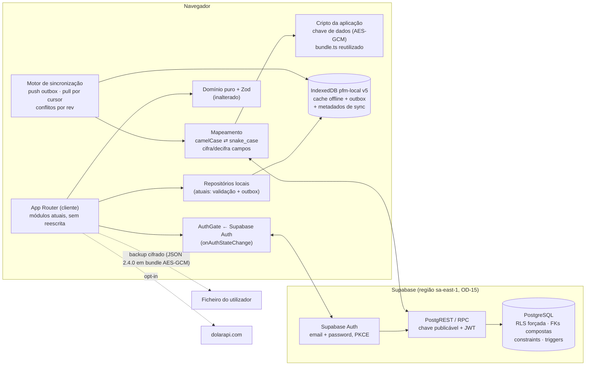

# Blueprint da migração para Supabase

Decisão: [ADR-006](../decisions/ADR-006-supabase-hibrido.md) · Auditoria: [STEP-11-ARCHITECTURE-AUDIT.md](STEP-11-ARCHITECTURE-AUDIT.md) · Tabelas: [postgresql-mapping.md](postgresql-mapping.md).

## 1. Arquitetura proposta

**Princípio:** a UI lê e escreve **sempre** no IndexedDB, exatamente como hoje. A nuvem é a fonte oficial porque o sincronizador a reconcilia com o IndexedDB, não porque a UI fale com ela. Por isso o offline continua a funcionar sem mudar os módulos.

## 2. Supabase Auth

### 2.1 Fluxos

| Fluxo | Implementação |
| --- | --- |
| Registo | `auth.signUp({ email, password, options: { emailRedirectTo } })`; confirmação por email obrigatória; trigger cria `profiles` e `user_settings` |
| Login | `auth.signInWithPassword`; mensagem genérica mantida |
| Sessão | `auth.onAuthStateChange` → `AuthProvider` (substitui `resolveSession`); refresh automático |
| Logout | `auth.signOut()` (+ opção "limpar dados deste dispositivo") |
| Mudar password | Reautenticação + `auth.updateUser({ password })`, depois `signOut({ scope: "others" })` |
| Recuperar password | `auth.resetPasswordForEmail` → página `/recuperar` (PKCE) |
| Rotas protegidas | `AuthGate` igual; a defesa real é a RLS |

### 2.2 Variáveis de ambiente

| Variável | Onde | Pública? |
| --- | --- | --- |
| `NEXT_PUBLIC_SUPABASE_URL` | Vercel + `.env.local` | Sim (por desenho) |
| `NEXT_PUBLIC_SUPABASE_PUBLISHABLE_KEY` (ou `..._ANON_KEY`) | Vercel + `.env.local` | Sim — **só segura com RLS** |
| `SUPABASE_SERVICE_ROLE_KEY` / secret key | **Só** CI (migrações/testes) — nunca `NEXT_PUBLIC_`, nunca no repositório | Não |
| `SUPABASE_DB_PASSWORD` | Só CI/CLI | Não |

`guard:artifacts` passa a falhar se encontrar no build padrões de chaves secretas (`service_role`, `sb_secret_`).

### 2.3 Armazenamento da sessão

`supabase-js` guarda a sessão no LocalStorage por omissão. Plano:

- adaptador `auth.storage` com `sessionStorage` quando "Recordar sesión" está desligado;
- LocalStorage só quando está ligado;
- `flowType: "pkce"`, refresh rotativo e tempo de vida do JWT curto (≤ 1 h);
- CSP estrita (§5.5).

**Risco residual dito sem rodeios:** qualquer armazenamento acessível por JavaScript fica exposto a XSS. A CSP é a defesa principal.

## 3. Esquema e RLS

- Todas as tabelas de dados têm `user_id uuid not null default auth.uid()` e `unique (user_id, id)`.
- **RLS `enable` + `force`** em todas. Políticas por operação, `to authenticated`, `user_id = (select auth.uid())`. **Sem política de DELETE** (tombstones). A role `anon` não tem acesso.
- **FKs compostas** `(user_id, x_id) → (user_id, id)` em todas as relações. A verificação de FK ignora a RLS, e é isto que impede referências a dados de outro utilizador (IDOR).
- **Invariantes no servidor**, porque um cliente modificado pode chamar a API diretamente:
  - CHECK para formas, valores e enums;
  - triggers para moedas coerentes, tipo de categoria, cartão da conta, árvore de categorias, períodos de orçamento e `rev`;
  - índice único parcial para "uma contribuição viva por transação".
- `server_updated_at` (trigger) em todas as tabelas, que é o cursor de sincronização.
- RPC `apply_operations(ops jsonb)` (`security invoker`): aplica um lote de operações do `outbox` com verificação de `base_rev`, idempotente por `operation_id` (`sync_operations`), e devolve aplicadas/conflitos.
- **Teste automático** (pgTAP ou script SQL na CI): falha se alguma tabela de `public` não tiver RLS forçada; testes com dois utilizadores para SELECT/INSERT/UPDATE e para FKs cruzadas.

## 4. Abstração de repositórios

| Peça | Hoje | Depois |
| --- | --- | --- |
| `Repository<N>` (interface) | Implementada sobre IndexedDB | **Inalterada** — continua a ser o que a UI usa |
| `UnitOfWork` | Registo + `outbox` atómicos | Inalterado |
| `RemoteDataSource` (novo, Step 16) | — | `pull(since)`, `push(ops)` sobre `supabase-js`; mapeamento snake/camel; cifra/decifra campos; valida com os **mesmos** esquemas Zod |
| `SyncEngine` (novo, Step 17) | — | Lê o `outbox` pendente, envia em lotes, marca operações, aplica o pull no IndexedDB sem gerar operações novas, regista conflitos |
| Hooks (`useLocalQuery`) | Leem IndexedDB | Iguais; `notifyDataChanged()` dispara também após um pull |

Reutilização direta: `ENTITY_SCHEMAS`, `REFERRERS`, `computeChecksums`, `transactionDuplicateKey`, `canonicalJson`, `bundle.ts`, `outbox`/`LocalOperation` (os campos `operationId`, `baseRev`, `record` e `conflict` já existem).

## 5. Cifragem ao nível da aplicação (Step 15 — exige revisão de desenho, OD-11/12/13)

1. **Âmbito recomendado (OD-11a):** campos de texto livre — nomes de contas, cartões, categorias, metas e orçamentos; descrições e notas; instituição; nome, telefone e região do perfil. Ficam em claro valores, datas, moedas, tipos, estados e IDs, porque o servidor precisa deles para constraints, índices, FKs e sincronização. **O fornecedor vê valores e datas; não vê descrições nem nomes.**
2. **Chaves (OD-12c):**
   - chave de dados aleatória (AES-256-GCM, não extraível depois de importada);
   - essa chave é embrulhada duas vezes, ambas com PBKDF2 600 000 iterações, como no `bundle.ts`: pela frase de dados do utilizador e por uma chave de recuperação mostrada uma vez;
   - os envelopes embrulhados vivem numa tabela `user_keys` com RLS. O servidor nunca vê a chave em claro.
3. **Formato de campo:** `enc:v1:<iv base64>:<ciphertext base64>`, com AAD = `tabela|coluna|id|user_id`. A AAD impede trocar valores entre linhas ou utilizadores.
4. **Recuperação (OD-13):**
   - sem a frase de dados e sem a chave de recuperação, os campos cifrados perdem-se para sempre (risco R1);
   - o reset de password por email **não** recupera a chave;
   - por isso a ativação exige guardar a chave de recuperação e passar num teste de decifra.
5. **CSP (Step 12):**
   - `default-src 'self'`;
   - `script-src 'self'` + hash do script de tema;
   - `connect-src 'self' https://<projeto>.supabase.co wss://<projeto>.supabase.co https://dolarapi.com`;
   - `img-src 'self' data:`, `frame-ancestors 'none'`, `base-uri 'self'`, `form-action 'self'`.
6. **Cache local:** o IndexedDB guarda os campos ainda cifrados. Decifram-se em memória ao ler, o que cumpre a OD-3 com a mesma chave.

## 6. Sincronização e offline (IndexedDB v5)

| Mudança v5 (aditiva) | Uso |
| --- | --- |
| `device.owner = { userId, linkedAt }` | A que utilizador pertence esta cache |
| store `sync_state` (`entity → { cursor: server_updated_at, lastPullAt }`) | Pull incremental |
| `outbox.syncedAt`, `outbox.serverResult` (campos novos, opcionais) | Estado do envio |
| Caches por utilizador: `pfm-cache-<userId>` para utilizadores que não são o dono de `pfm-local` | Nunca misturar contas |

**Ciclo:**

1. A escrita local (como hoje) gera uma operação no `outbox`.
2. Com rede e sessão, o push envia lotes ordenados por dependência (contas → categorias → cartões → recorrências → contas domésticas → transações → metas → contribuições) através de `apply_operations`.
3. Operação aplicada: marca `syncedAt`. Conflito (`base_rev` desatualizado): marca `conflict` e mostra-o na UI. **Nunca é resolvido automaticamente** (regra existente).
4. O pull (`server_updated_at > cursor`) traz as linhas para o IndexedDB sem gerar operações, avança o cursor e dispara `notifyDataChanged()`.
5. Offline: tudo continua; o `outbox` cresce; o indicador de dados (`DataStatus`) mostra as alterações por sincronizar.

Gatilhos: arranque, `online`, intervalo (ex.: 60 s com o separador visível) e depois de cada escrita, com *debounce*. Realtime do Supabase fica como otimização posterior.

## 7. Migração de contas e dados locais (Step 18)

1. **Antes de tudo:** backup cifrado local automático (Step 19 pode vir antes, se preferido) e contagens/somas (`computeChecksums`).
2. Com a conta local aberta, o utilizador escolhe "Conectar con la nube" e cria (ou entra numa) conta Supabase com email. A password é nova para o Supabase; pode escrever a mesma.
3. Se a nuvem desse utilizador estiver **vazia**, os registos são enviados com os mesmos IDs, em lotes por dependência, de forma idempotente (`on conflict (id) do nothing` + verificação de dono). Os `profiles`/`user_settings` locais vão para as tabelas da nuvem.
4. Se a nuvem **já tiver dados** (outro dispositivo), mostra-se uma pré-visualização com IDs comuns e conflitos (`previewImport` reutilizado), e o utilizador decide. Nada é sobrescrito sem confirmação.
5. Verificação: os checksums locais têm de ser iguais aos da nuvem. Só então `device.owner` é gravado e a conta local é retirada (as stores `credentials`/`sessions` ficam, inativas, até uma limpeza explícita futura).
6. **Nunca** `indexedDB.deleteDatabase`; o `pfm-local` continua a ser a cache.

## 8. Backup e recuperação (Step 19)

- **Exportar:** JSON 2.4.0 completo (`exportData`, já existente) → `bundle.ts` (PBKDF2 600k + AES-256-GCM, AAD com versão), com frase escolhida no momento. Inclui perfil e definições; nunca tokens nem chaves.
- **Importar:** decifrar → validar (4 camadas existentes) → pré-visualizar → aplicar no IndexedDB → sincronizar. O rollback de um nível continua a existir.
- É independente da nuvem: serve também para sair do Supabase.

## 9. Roteiro Steps 12–20

Numeração fixada pelo proprietário no brief do Step 12: tabelas no Step 13, Supabase Auth no Step 14, RLS no Step 15, cifragem da aplicação no Step 18. Os conteúdos dos Steps 16, 17, 19 e 20 seguem a proposta da auditoria e podem ser reordenados.

| Step | Conteúdo | Depende de | Entrega verificável |
| --- | --- | --- | --- |
| **12 — Fundações** ✅ | `@supabase/supabase-js` + `@supabase/ssr`; guardas; config Zod; clientes browser/servidor; proxy Next 16; health check; CSP; docs | ADR-006 | Feito ([SUPABASE_SETUP.md](../SUPABASE_SETUP.md)) |
| **13 — Esquema PostgreSQL** ✅ | `database/sql/00–08` (+99) para o SQL Editor: 17 tabelas, FKs compostas, CHECK, triggers, auditoria, RLS ativa sem políticas; tipos gerados | 12 | Feito: validado em PostgreSQL local ([STEP-13-VALIDATION.md](../database/STEP-13-VALIDATION.md)); execução no Supabase pelo utilizador |
| **14 — Supabase Auth** | Registo/login/logout/verificação/recuperação; `profiles`/`user_settings`; proxy protege rotas com `getClaims()` | 12, 13 | E2E de auth contra Supabase local |
| **15 — RLS** | Políticas por operação, `force`, testes IDOR com dois utilizadores, teste "nenhuma tabela sem RLS" | 13, 14 | Testes de RLS verdes |
| **16 — Camada remota** | `RemoteDataSource`, mapeamento snake/camel, validação Zod | 15 | Ida-e-volta por entidade |
| **17 — Sincronização** | IndexedDB v5, push/pull, conflitos, offline, multi-dispositivo | 16 | E2E com dois dispositivos e offline |
| **18 — Cifragem da aplicação** | Revisão de desenho (OD-11/12/13), chave de dados, envelopes, recuperação, cache cifrada | 15 | Testes de cifra/AAD/recuperação |
| **19 — Migração de contas e dados locais** | "Conectar con la nube", reclamação idempotente, checksums, retirada do login local | 14, 17, **18** | Dados locais → nuvem → segundo dispositivo, sem perdas |
| **20 — Backup cifrado e endurecimento** | Exportar/importar cifrado (OD-5); revisão de segurança, CSP com nonce, desempenho, retirar o pipeline GitHub | 12–19 | Relatório de QA final |

> **Avisos de ordem:**
> 1. **Step 13 sem RLS:** uma tabela criada em `public` sem RLS fica legível e gravável por quem tenha a chave publicável. As migrações do Step 13 devem ativar `enable row level security` em cada tabela no momento da criação (negar tudo por omissão); as políticas chegam no Step 15.
> 2. **Cifragem no Step 18:** nenhum dado financeiro real deve ser enviado para a nuvem antes do Step 18. Se a sincronização do Step 17 for usada com dados reais antes disso, esses dados ficam em claro na base e nos backups do Supabase (risco R7). A migração dos dados locais fica no Step 19, depois da cifragem.
