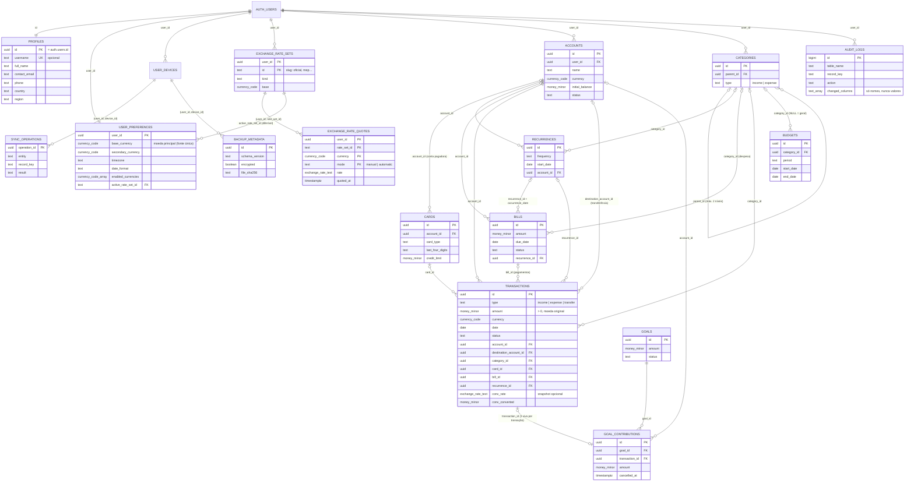

# Diagrama de entidades (Step 13)

Fonte: `database/sql/02–05`. Todas as tabelas estão em `public`, com RLS ativa e sem políticas até ao Step 15.

**Convenções:**

- Cada tabela de dados tem `user_id → auth.users.id` (com eliminação em cascata).
- As relações entre tabelas do utilizador são **chaves estrangeiras compostas** `(user_id, x_id) → (user_id, id)`.
- O diagrama mostra os campos de relação e os principais. A lista completa está em [TYPESCRIPT-POSTGRES-MAPPING.md](TYPESCRIPT-POSTGRES-MAPPING.md).

**Colunas comuns às 9 tabelas financeiras** (`controlFields` da app):

| Coluna | Papel |
| --- | --- |
| `id`, `user_id` | Identidade e dono |
| `rev` | Concorrência otimista |
| `created_at`, `updated_at` | Datas do cliente |
| `deleted_at` | Tombstone |
| `device_id` | Dispositivo que escreveu |
| `server_updated_at` | Cursor de sincronização |
